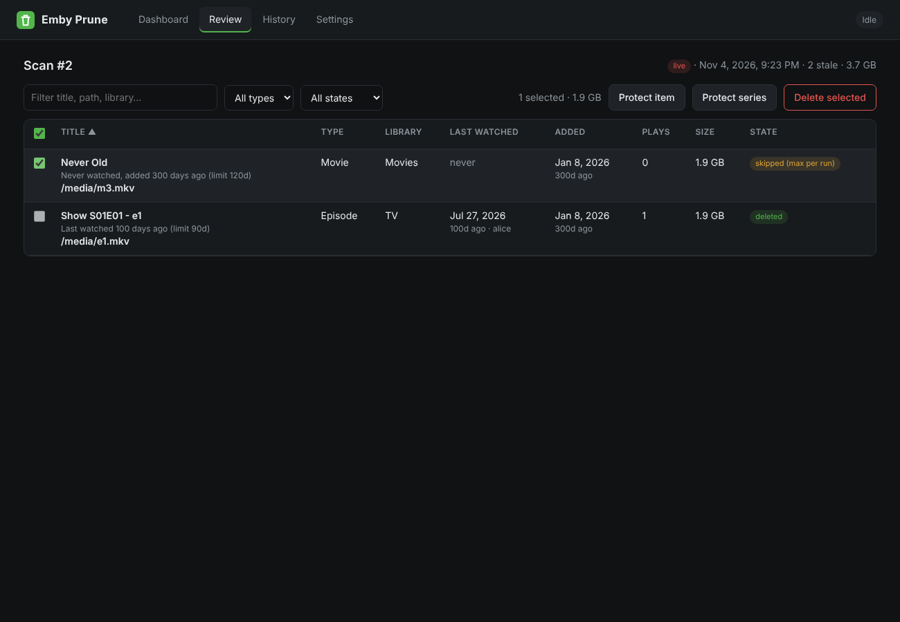

# Emby Prune

[](https://github.com/jwklijnsma/emby-prune/actions/workflows/docker.yml)

Automatic clean-up of old movies and TV episodes on an Emby server, based on what **any user** actually watches — with a web GUI.

Built on the logic from [this Emby community post](https://emby.media/community/topic/144601-automatic-emby-media-pruning-movies-tv-episodes-using-a-custom-docker-script-%E2%80%93-any-user-watch-logic) (mojavaid36), and extended with the features that post listed as "maybe later".



## Rules

| | Watched by someone | Never watched |
|---|---|---|
| **Movies** | deleted when the latest play by *any* user is older than `movie_days` (120) | deleted when added more than `movie_never_played_days` (120) ago |
| **TV episodes** | deleted when the latest play by *any* user is older than `tv_days` (90) | deleted when added more than `tv_never_played_days` (180) ago |

Set any value to `0` to switch that rule off. Items are removed through the Emby API (`DELETE /Items/{id}`), so Emby cleans up both library and files.

**Never deleted:**
- libraries you untick in Settings
- items or whole series carrying the keep tag (default `keep`) in Emby
- items or series favourited by any user (toggle)
- items / series you add to the protected list from the Review page
- virtual "missing" episodes (no file)

## What the GUI adds over the original script

- **Dashboard** – dry run / run & delete buttons, live log, next scheduled run, last result
- **Review** – every stale item with reason, last watched (and by whom), added date, size; filter, sort, bulk **delete selected** or **protect**
- **History** – every run, browsable
- **Settings** – connection test, rules, libraries, keep tag, favourites, safety cap, schedule (cron with presets), notifications
- **Safety:** dry-run by default; max deletions per run (default 50); selected deletions re-check each item with Emby first and skip anything watched since the scan
- **Built-in scheduler** (no external cron needed)
- **Webhook notifications** – Discord, Slack, ntfy or generic JSON
- **Much faster scans** – one paged request per user instead of one request per item per user
- Optional **basic auth**, logs to `/config/logs`, run history in SQLite

## Install

Prebuilt image (amd64 + arm64): `ghcr.io/jwklijnsma/emby-prune:latest`

```bash
git clone https://github.com/jwklijnsma/emby-prune && cd emby-prune
# edit docker-compose.yml: TZ, WEB_USERNAME / WEB_PASSWORD
docker compose up -d            # uses the GHCR image
# or build locally:  docker compose up -d --build
```

Open `http://<host>:8585`, go to **Settings**, enter your Emby URL (e.g. `http://192.168.1.10:8096/emby`) and an API key (Emby Dashboard → Advanced → API Keys), click **Test connection**, pick libraries, save.

Then run a **Dry run**, check the **Review** tab, and only then either delete selected items, use **Run & delete**, or untick "Dry-run scheduled runs" to let the schedule delete.

Unraid: use `ghcr.io/jwklijnsma/emby-prune:latest` as the repository, map `/config` to `/mnt/user/appdata/emby-prune` and port 8585.

## Environment variables

All optional. The Emby/rule variables only seed the first-run settings; after that the GUI's `settings.json` is used.

| Variable | Default | |
|---|---|---|
| `TZ` | `UTC` | Time zone for the schedule |
| `WEB_PORT` | `8585` | GUI port |
| `WEB_USERNAME` / `WEB_PASSWORD` | – | Enable basic auth on the GUI |
| `EMBY_URL` / `EMBY_API_KEY` | – | Seed connection |
| `MOVIE_PRUNE_DAYS` (or `PRUNE_DAYS`) | 120 | |
| `MOVIE_NEVER_PLAYED_DAYS` | = movie days | |
| `TV_PRUNE_DAYS` | 90 | |
| `TV_NEVER_PLAYED_DAYS` | 180 | |
| `DRY_RUN` | `true` | Applies to scheduled runs |
| `MAX_DELETES` | 50 | 0 = unlimited |
| `KEEP_TAG` | `keep` | |
| `SCHEDULE_ENABLED` / `SCHEDULE_CRON` | `false` / `0 3 * * 1` | |
| `WEBHOOK_URL` | – | |

## Run-once mode (external scheduler)

Prefer the original "container runs, then exits" style?

```bash
docker run --rm -v ./config:/config ghcr.io/jwklijnsma/emby-prune python -m app.cli          # follows the DRY_RUN setting
docker run --rm -v ./config:/config ghcr.io/jwklijnsma/emby-prune python -m app.cli --live   # deletes
```

Exit code is non-zero when the run fails.

## API

The GUI is a thin client over a JSON API (same basic auth): `GET /api/status`, `POST /api/run {"mode":"dry"|"live"}`, `POST /api/cancel`, `GET /api/runs`, `GET /api/runs/<id>`, `POST /api/runs/<id>/delete {"ids":[…]}`, `GET/POST /api/settings`, `POST /api/protect`, `GET /healthz`.

## Notes

- The API key is stored in `/config/settings.json` (mode 600) and never sent back to the browser.
- Emby removes empty seasons/series itself on the next library scan.
- Deleting is permanent. Start with dry runs.
