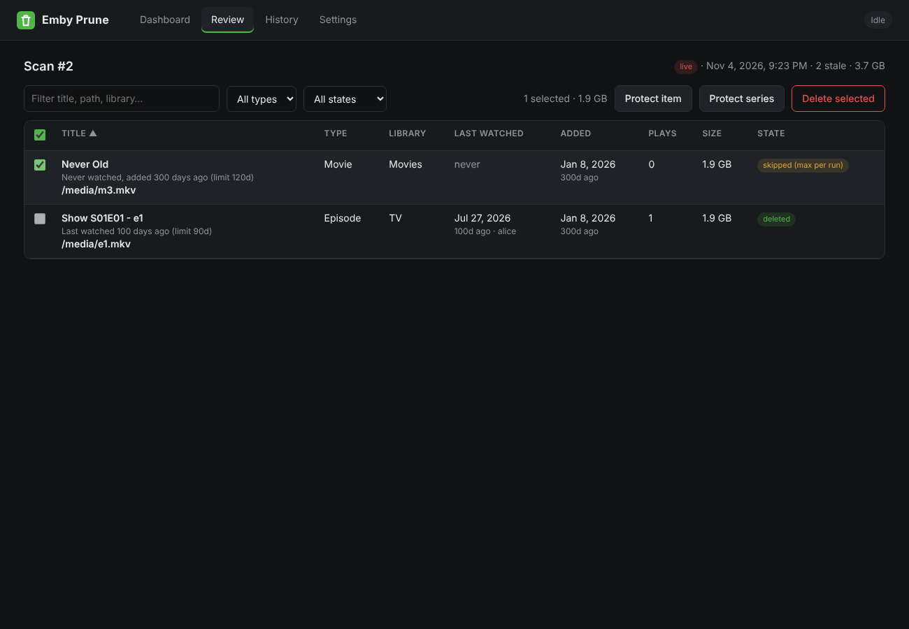

# Emby Prune

**Old movies and TV episodes on your Emby server cleaned up automatically** — based on
what *any* user actually watches, with a web GUI to review everything first.

-   :material-rocket-launch: **[Install](install.md)**

    `docker compose up -d`, open port 8585, connect Emby.

-   :material-scale-balance: **[Pruning rules](rules.md)**

    Watched and never-watched rules for movies and episodes.

-   :material-monitor-dashboard: **[Web GUI](gui.md)**

    Dry runs, review, history, settings and schedule.

-   :material-shield-check: **[Safety notes](notes.md)**

    Dry-run by default, deletion cap, keep tag and favourites.

## Features

| Feature | What you get |
|---|---|
| **Any-user watch logic** | An item stays as long as *someone* watched it recently |
| **Review before delete** | Every stale item with reason, last watched (and by whom), size; bulk delete or protect |
| **Safe by default** | Dry run, max deletions per run, re-check with Emby before each delete |
| **Never deleted** | Unticked libraries, the `keep` tag, favourites, the protected list, virtual episodes |
| **Built-in scheduler** | Cron with presets, no external cron needed |
| **Notifications** | Discord, Slack, ntfy or generic JSON webhooks |
| **Fast scans** | One paged request per user instead of one per item per user |
| **API** | Everything the GUI does is a JSON API |

!!! warning "Deleting is permanent"
    Items are removed through the Emby API, which deletes the files too. Start with dry runs.
